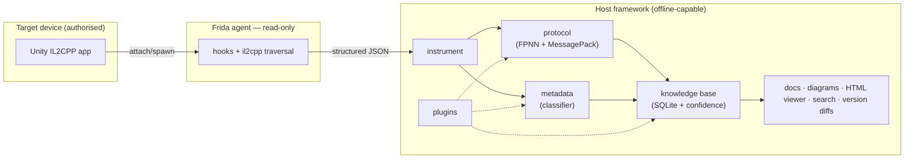

<div align="center">

# Vantage

**An observation-only runtime analysis & protocol-intelligence framework for Unity IL2CPP applications.**

[](https://github.com/emon5122/vantage/actions/workflows/ci.yml)
[](LICENSE)
[](pyproject.toml)
[](https://github.com/psf/black)
[](https://github.com/astral-sh/ruff)
[](tests/)

*Read what the runtime already produced — never make the target do anything it wouldn't do on its own — and turn every authorised observation into permanent, evidence-graded, queryable knowledge.*

</div>

---

## Overview

**Vantage** is a modular framework for understanding hardened **Unity IL2CPP**
Android applications and their network protocols through **static and dynamic
observation only**. It spans the full workflow — from binary/metadata analysis,
to read-only runtime instrumentation, to wire-protocol decoding, to a
self-improving SQLite **protocol knowledge base** that gets more accurate as more
sessions are captured.

It is **strictly observation-only** by design. There is no primitive anywhere in
the codebase for cheating, automation, packet injection/replay, memory
modification, key extraction, or anti-tamper bypass — and there never will be
(see the [threat model](docs/threat-model.md)).

> **Not a game tool.** Vantage is a *reusable* framework for Unity IL2CPP and the
> FPNN/MessagePack protocol family. It ships **no** proprietary binaries and **no**
> target-specific data; all examples are **synthetic** and clearly marked.

## Features

- **Runtime instrumentation** (Frida, read-only): library load order, `JNI_OnLoad`,
  `RegisterNatives`, native/DNS/socket observation, Lua VM tracing, and runtime
  string recovery — every hook reads, none modify.
- **IL2CPP metadata recovery**: walk the in-memory type system via the runtime's
  own read-only API (`Assembly → Image → Namespace → Class → Method` + RVAs),
  with a layered locator that also handles builds whose export names are stripped.
- **Protocol analysis**: a dependency-free **MessagePack** decoder and an **FPNN**
  framer, with quest/answer correlation, heartbeat/push/retry detection, and
  per-command **schema inference** graded `Verified / Likely / Unknown`.
- **Knowledge base**: versioned, deduplicated SQLite store with a **confidence
  engine** that never downgrades, automatic opcode learning, a knowledge graph,
  version diffing / migration reports, a search engine, and auto-generated docs +
  a self-contained HTML viewer.
- **Evidence model**: every fact carries a grade, an observation count, a version,
  a timestamp, a source, and a human-readable reason. The framework says
  *"Unknown"* rather than guessing.
- **Plugin architecture**: extend serialization decoders, classifier rules, and KB
  importers without touching the core.
- **Offline-first**: the analysis, KB, docs, and viewer have **zero third-party
  runtime dependencies** and run without a device. Frida is an optional extra.

## Architecture



See [docs/architecture.md](docs/architecture.md) for module, data-flow, capture,
metadata, protocol, knowledge-base, versioning, and plugin diagrams.

## Example output

Decoded FPNN frame + inferred schema, from the **synthetic** sample session:

```jsonc
// frames.jsonl (synthetic)
{ "method": "login", "header": { "mtype_name": "twoway_quest" }, "seq": 1,
  "payload": { "#1": "user", "#2": "token", "#3": 42 }, "_synthetic": true }
```
```text
$ vantage kb --db kb.db search field '#1'
  method:ping    Verified 5/5      # promoted to Verified after 5 samples
  method:login   Unknown  1/1      # stays Unknown until enough samples accrue
```
```text
$ vantage kb --db kb.db diff 1.0.0 2.0.0
new_opcodes:      1   (method:newcmd)
changed_schemas:  1   (method:login: added #9)
```
More in [`examples/`](examples/) and [`sample-data/`](sample-data/) (all synthetic).

## Installation

```bash
# offline analysis, knowledge base, docs — no third-party runtime deps
pip install -e .

# add the optional live-instrumentation layer (Frida)
pip install -e '.[instrument]'

# development (tests, linters)
pip install -e '.[dev]'
```

No install? Use the bundled launcher or `PYTHONPATH`:

```bash
./vantage version
PYTHONPATH=src python3 -m vantage version
```

## Quick start

```bash
# 1) generate a synthetic capture session (no device needed)
vantage protocol synth sample-data/demo --label login

# 2) build protocol artifacts from captures
vantage protocol build sample-data/demo --out out/protocol --target demo

# 3) load it into a versioned knowledge base
vantage kb --db out/kb.db import sample-data/demo --version 1.0.0 --label login

# 4) query, diff, and view
vantage kb --db out/kb.db search field '#1'
vantage kb --db out/kb.db docs --version 1.0.0 --out out/docs
vantage kb --db out/kb.db serve            # self-contained viewer @ 127.0.0.1:8765
```

Live capture against an **authorised** target (needs `frida-server` matching the
target ABI):

```bash
vantage instrument capture --attach --label send_action
vantage protocol build vantage_data/captures/session_* --out out/protocol
```

## Directory structure

```
src/vantage/     agent (JS) · instrument · protocol · metadata · kb · plugins · configs · cli
tests/           pytest suite (offline; no device)
docs/            architecture, design, components, api, threat-model, ethics, ...
sample-data/     synthetic inputs (clearly marked)
examples/        synthetic example outputs
plugins/         drop-in plugin directory (example included)
.github/         CI, release, issue/PR templates, dependabot
```

## Support matrix

| Dimension | Supported |
|---|---|
| **Engine** | Unity IL2CPP (2018.4 – 2022.3 metadata layouts v24–v29) |
| **Platform** | Android (ARM32 / ARM64); offline analysis is OS-independent |
| **Protocol framing** | FPNN (TCP); pluggable for others |
| **Serialization** | MessagePack (built-in); Protobuf/FlatBuffers/custom via plugins |
| **Instrumentation** | Frida ≥ 16.2 (optional); frida-server must match target ABI |
| **Python** | 3.9+ |

## Plugin architecture

Extend three observation-only seams — `serialization`, `classifier`,
`kb_importer` — with a small `PLUGIN` dict + `register(registry)` function.
Discovery is via entry points or a `plugins/` directory. See
[docs/design/plugin-system.md](docs/design/plugin-system.md) and the working
[`plugins/example_classifier_rules.py`](plugins/example_classifier_rules.py).

## Research methodology

Vantage encodes a disciplined method: **observe → grade → correlate → accumulate**.
Every recovered fact is tagged with its evidence source and confidence; framing is
grounded in public standards (`spec`) and only promoted to `observed` once seen on
the wire; opcodes and schemas are *only* emitted when captured. Read the
[evidence model](docs/design/evidence-model.md) and
[confidence engine](docs/design/confidence-engine.md).

## Limitations

TLS transports yield ciphertext at the socket layer; hardened targets require
researcher-supplied offsets for full metadata recovery; anti-analysis is not
evaded. Full list in [docs/limitations.md](docs/limitations.md).

## Responsible disclosure

Use Vantage only on software you are authorised to analyse. If your research
uncovers a vulnerability in a third-party application, follow **coordinated
disclosure** and never publish captured user data or exploits. See
[docs/ethics-and-responsible-research.md](docs/ethics-and-responsible-research.md).
To report a vulnerability in Vantage itself, see [SECURITY.md](SECURITY.md).

## Roadmap

Managed-level protocol hooks, bundled Protobuf/FlatBuffers decoders, iOS parity,
and a Postgres backend option — see [docs/roadmap.md](docs/roadmap.md). Automation,
injection, and bypass features are **permanently out of scope**.

## Contributing

Contributions are welcome. Please read [CONTRIBUTING.md](CONTRIBUTING.md) and the
[Code of Conduct](CODE_OF_CONDUCT.md). All contributions must preserve the
observation-only guarantee; CI rejects behaviour-altering hooks.

## License

[Apache-2.0](LICENSE).

## Acknowledgements

Built on the shoulders of the open-source RE community: [Frida](https://frida.re),
the [FPNN](https://github.com/highras/fpnn) protocol, the
[MessagePack](https://msgpack.org) specification, and Unity IL2CPP research such as
[Il2CppDumper](https://github.com/Perfare/Il2CppDumper) and
[Il2CppInspector](https://github.com/djkaty/Il2CppInspector). Vantage integrates
ideas from these ecosystems into a single, observation-only framework.

## FAQ

**Is this a cheat / bot / game hacking tool?** No. It cannot modify a target,
inject or replay traffic, or automate anything — those primitives don't exist in
the codebase and are permanently out of scope.

**Does it break DRM / anti-cheat / packing?** No. It observes state the runtime
already produced and degrades gracefully where a target is hardened. It never
extracts keys or decrypts what the runtime hasn't already decrypted for itself.

**Do I need a rooted device?** Only for the optional live-instrumentation layer
(Frida). All analysis, the knowledge base, docs, and the viewer run offline.

**Which games/apps does it target?** None specifically — it's a reusable framework
for Unity IL2CPP + FPNN/MessagePack. Ships no proprietary data; examples are
synthetic.

**How does it "get more accurate over time"?** Schema fields accumulate samples
across captures and auto-promote `Unknown → Likely → Verified`; the confidence
engine never downgrades. More authorised observation → higher confidence, no extra
reverse engineering.
