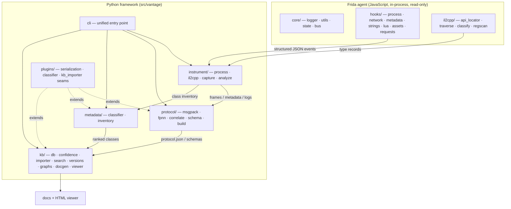
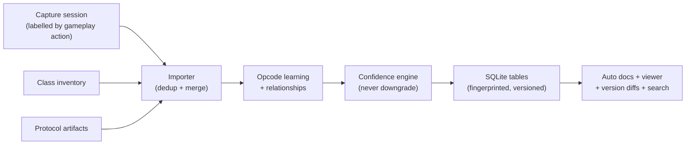
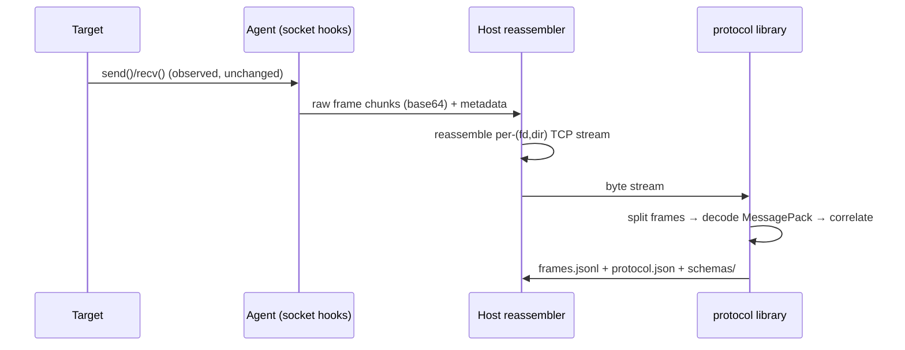
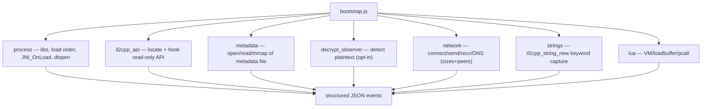
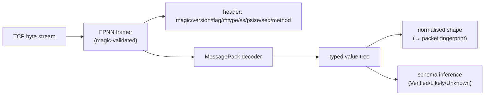
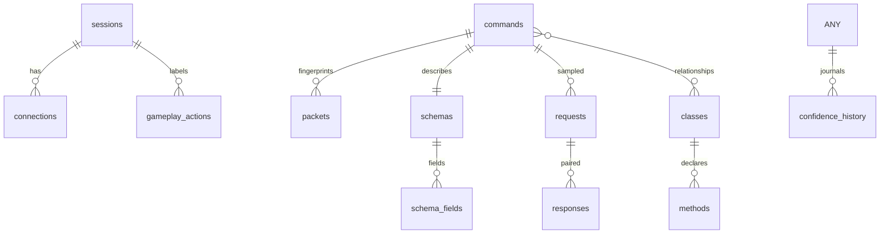
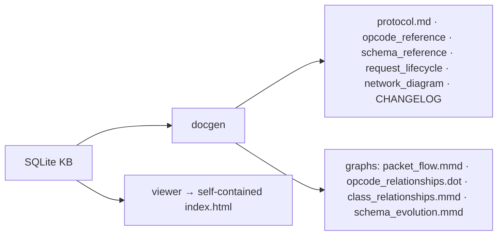
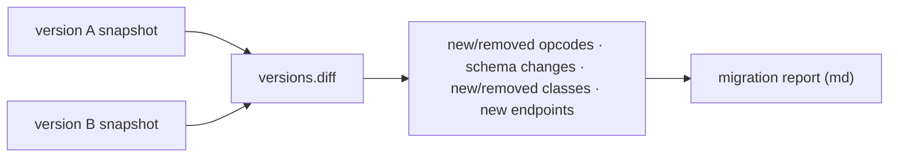
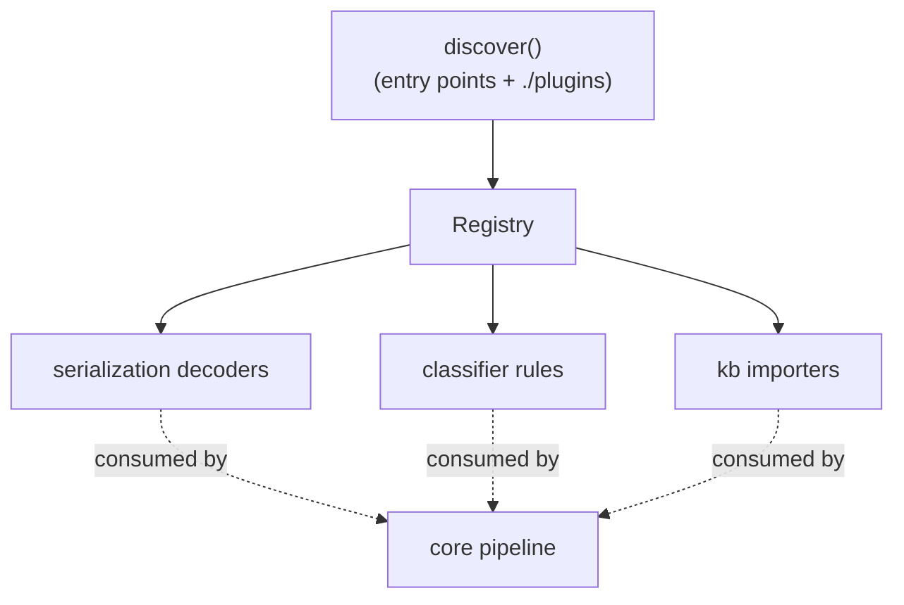
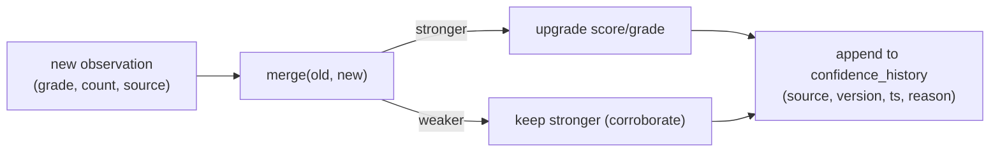

# Architecture

Vantage is a layered, observation-only framework for analysing Unity **IL2CPP**
applications on Android. Each layer produces structured artifacts that the next
layer consumes; nothing in the pipeline transmits, injects, replays, or modifies
target state.

## Design in one sentence

> Read what the runtime has already decrypted, decoded, or connected — never make
> the target do anything it would not do on its own — and turn each authorised
> observation into permanent, evidence-graded, queryable knowledge.

---

## Module architecture



---

## Data flow

```mermaid
flowchart LR
  A["Target process\n(Unity IL2CPP)"] -->|Frida attach/spawn| B["Agent hooks\n(read-only)"]
  B -->|send(JSON)| C["Host logger\n→ events.jsonl"]
  C --> D["Reducers\n(analyze / build)"]
  D --> E["Artifacts\nframes.jsonl · types.json · protocol.json · schemas/"]
  E --> F["Knowledge base\n(SQLite)"]
  F --> G["Docs · Diagrams · HTML viewer · Search · Version diffs"]
```

---

## Knowledge pipeline



---

## Capture pipeline (protocol)



---

## Runtime instrumentation



---

## Protocol decoding



---

## Knowledge base



---

## Documentation generation



---

## Version comparison



---

## Plugin system



---

## Confidence engine



---

## Repository layout

```
vantage/
├── src/vantage/            importable package
│   ├── agent/              Frida JS agent (core/, hooks/, il2cpp/)
│   ├── instrument/         Python launchers (frida-optional)
│   ├── protocol/           FPNN + MessagePack + correlation + schema + build
│   ├── metadata/           managed-class classifier + inventory
│   ├── kb/                 SQLite knowledge base + docgen + viewer
│   ├── plugins/            plugin registry + discovery
│   ├── configs/            default config + offsets template
│   └── cli.py              unified `vantage` entry point
├── tests/                  pytest suite (offline; no device needed)
├── sample-data/            synthetic inputs (clearly marked)
├── examples/               example outputs (synthetic)
├── plugins/                drop-in plugin directory (example included)
├── docs/                   this documentation set
├── scripts/                developer helpers
├── .github/                CI, templates, automation
└── pyproject.toml          packaging + tooling config
```

See [design/philosophy.md](design/philosophy.md) for the reasoning behind these
boundaries, and [components/](components/) for per-subsystem detail.
